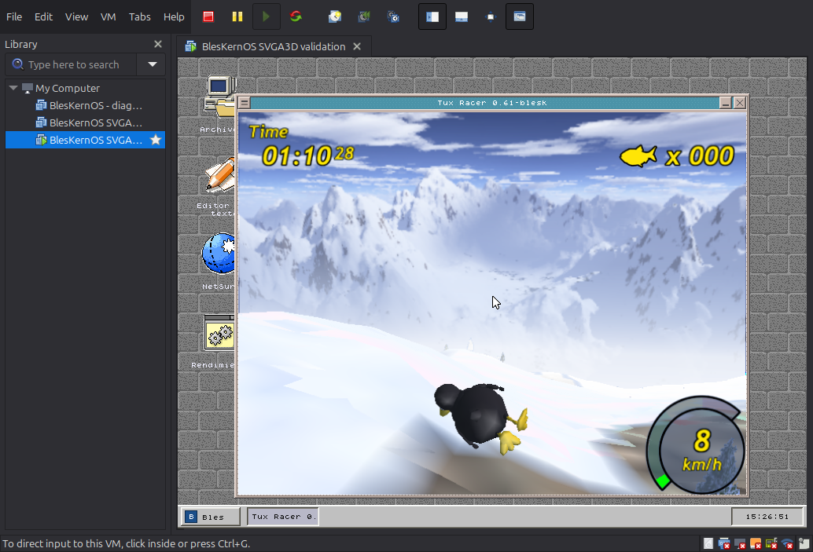
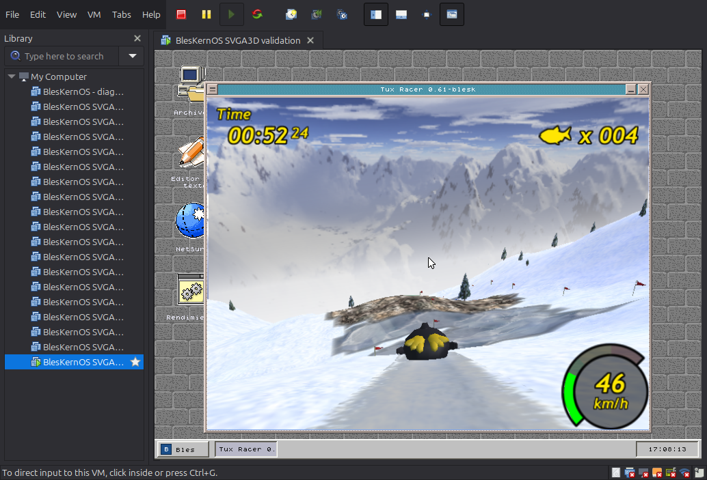

# SVGA3D: activación comprobada y Tux Racer

## Uso

```sh
make -j4 vmware-image
vmware build/bleskernos-vmware-user.vmx
```

Abrir el **VMX generado junto al VMDK**. El perfil utiliza hardware virtual 10,
`mks.enable3d = "TRUE"` y `svga.vgpu10 = "FALSE"`, con 256 MiB de RAM y un
procesador. El generador no modifica perfiles personales de VMware. No actualizar
este perfil a hardware virtual 22 esperando conservar el protocolo 3D legacy.
Con la VM apagada se puede reconstruir la imagen. El disco generado es una imagen
de distribución, por lo que no debe usarse para conservar datos personales entre
recompilaciones.

Tux está instalado como `/SYSTEM/PROGRAMS/TUXRACER.BEX`. Se puede abrir desde
Archivos o escribir `tuxracer` en Ejecutar. Enter pasa del logo al menú; `p` abre
Practice, y Enter inicia la carrera seleccionada. El log serie queda junto al
VMX, en `bleskernos-serial.log`.
Si aparece la animación inicial en la línea de salida, otra tecla la omite.

## Qué estaba fallando

La presencia de `SVGA_CAP_3D`, `devcap3d=1`, fences que avanzan y comandos escritos
al FIFO **no demuestra que los comandos legacy hayan producido píxeles**. El
driver 2D anterior sustituía versiones FIFO nulas por `0x20001` cuando veía la
capacidad 3D moderna. El supuesto `host=0x20001` podía ser un valor inferido.

En VMware Workstation 26.0.0 build 25388281, con hardware virtual 22, la prueba
DMA legacy dejó intacto el patrón de memoria `0xa5a5a5a5`. Un readback que conserva
el color previamente subido no distingue este caso de un draw que no escribe.
Con hardware 10 **y** `svga.vgpu10=FALSE`, las versiones FIFO reales fueron
`0x20001` y el recorrido DMA/draw/readback produjo los píxeles esperados.
Desactivar solamente vgpu10 manteniendo hardware 22 tampoco resolvió esa prueba.

Además se corrigieron errores compartidos por los consumidores de GFX3D:

* El transporte permitía sólo 16 reservas de VRAM, mientras el driver admitía
  32 surfaces, cada una con color y potencialmente profundidad, más vértices.
  El compositor podía fallar aun con memoria disponible. El límite compartido
  pasó inicialmente a 96. La revisión de rendimiento lo amplía a 224;
  una aserción exige capacidad para las 193 reservas del máximo 3D actual.
* `SVGA3D_RS_FILLMODE` empaqueta modo y cara en dos campos de 16 bits. `3` dejaba
  la cara en INVALID; FILL + FRONT_BACK debe ser `0x00040003`.
* Se fija explícitamente el rango Z y el estado de coordenadas de textura; la
  segunda etapa de textura queda desactivada.
* Cada draw restaura sus propios attachments de color/profundidad. El contexto
  es compartido: el compositor puede usar otro destino entre BEGIN y DRAW.
* La composición 2D convierte bordes de píxel a centros POSITIONT con un
  desplazamiento de `-0.5` en X/Y. Antes una copia 1:1 con filtro lineal devolvía
  `0xff0c1600` donde correspondía `0xff0f1900`, y deformaba texto y fondos.
* Las ventanas pertenecen a un **proceso**, no al hilo que esté ejecutando la
  llamada. `bk_sys_getpid()` ahora coincide con SYS_GETPID, y las rutas de
  presentación CPU y viewport GPU comprueban `task_current_process_id()`.
  La prueba real pasó de `owner=8 process=6 tid=8` (rechazo) a
  `owner=6 process=6 tid=8` (aceptación).
* Publicar un viewport conserva un frame completo en otra surface GPU. El
  compositor deja de muestrear el destino mutable de la aplicación, que puede
  estar a mitad del siguiente frame cuando se mueve el ratón o cambia el reloj.
  La copia usa la GPU y conserva RGBA; no hace readback a RAM. Las surfaces se
  liberan al retirar el viewport, destruir la ventana o reiniciar el compositor.
  Esta ruta es común a todos los clientes de `bk_gui_window_set_gpu_viewport`.
  Los buffers compartidos del compositor se asignan al kernel aunque la primera
  publicación venga de una aplicación, para sobrevivir a la liberación de su heap.
* BEGIN sin clear evita emitir de nuevo un estado que DRAW va a reemplazar.
  Esperar una fence ya completada evita una salida innecesaria a VMware.
  La composición de frames normales reutiliza también el título ya capturado,
  sin volver a dibujar sus letras una por una.

Se conserva la corrección anterior de `rangeHint=[first,last)`, con `last` igual
al número de vértices. Las aserciones de compilación verifican tamaños y offsets
del protocolo y del vértice público, para detectar cambios incompatibles.

En el port de Tux, Enter se traduce a `13`, como esperan sus callbacks. También
se registra la ruta de presentación **que efectivamente tuvo éxito**. En Ejecutar
se reconocen `.BEX` y ejecutables Win32 antes de caer en abrir como documento.

## Validación automática para todos los clientes

`VMWARESVGA3D.DVR` ejecuta una prueba pequeña antes de anunciar disponibilidad.
No depende de Tux, de un SID fijo ni del color de una escena. Crea superficies
temporales y comprueba:

1. DMA de ida/vuelta: subir un patrón, esperar la fence, envenenar el staging y
   leer de nuevo desde el host. Así no se confunde memoria local con un readback.
2. Clear y triángulo rojo, con un píxel exterior que debe permanecer intacto.
3. Textura con colores conocidos y coordenadas U/V verificables.
4. Alpha blending y reutilización de los 256 slots de vértices protegidos por fences.
5. Profundidad y cambio a otro render target entre dos draws.
6. Composición escalada con scissor y píxeles exteriores intactos.
7. Copia de un subrectángulo con filtros nearest/linear: todos sus 256 píxeles
   deben coincidir, incluida la alineación de centros de texels.
8. Publicación: copiar RGBA semitransparente, modificar el origen y comprobar
   que los 256 píxeles publicados conservan su color y alpha.
9. Alpha test: ocho comparaciones por tres referencias, con alpha de textura.
10. División de batches grandes y combinación DECAL conservando alpha difuso.
11. Capacidad simultánea: crear las 96 surfaces con profundidad, además del
   buffer de vértices (193 reservas), y comprobar un readback del último destino.
   Esta fase también detecta un `VMWARESVGA.DVR` antiguo mezclado con el nuevo 3D.

Si alguna fase falla, `available=false` y el driver libera sus recursos. Mesa y
TinyGL pueden seleccionar su fallback normal; no se anuncia una GPU funcional
que sólo produce un fondo vacío. El fallo se recuerda durante la generación del
transporte para evitar repetir la prueba en cada frame. Un reset o cambio de
generación permite volver a validarlo.

Ejemplo de éxito:

```text
[SVGA3D:SELFTEST] dma pixel=0xff193b57 expected=0xff193b57 poison=0xa5a5a5a5
[SVGA3D:SELFTEST] triangle pixel=0xffff0000 expected=0xffff0000 outside=0xff102030
[SVGA3D:SELFTEST] published pixel=0x8040a060 expected=0x8040a060
[SVGA3D:SELFTEST] surfaces=96 color+depth+vertices=193
[SVGA3D:SELFTEST] PASS phase=surface-budget
[SVGA3D.DVR] activo sobre vmware_svga; pixel validation passed
[GUI:GPU] viewport owner=6 process=6 tid=8 surface=513
[TUXRACER] present=gpu surface=513
```

Los IDs son ilustrativos. El handshake distingue `protocol`, `legacy`, `revised`
e `inferred`: un protocolo inferido requiere igualmente superar la prueba.
Las trazas de uploads/draws son acotadas y no generan un log por cada frame.

Esto automatiza una prueba de conformidad del backend común. No demuestra todas
las combinaciones de OpenGL ni convierte en aceleradas las funciones que Mesa
todavía implementa por software. Tampoco implementa objetos GB/MOB de VMware
moderno: el perfil compatible usa el protocolo legacy ya implementado.

## Reproducir la prueba de integración

```sh
python3 tools/build_svga3d_validation.py
vmware build/svga3d-smoke/test.vmx
```

Cuando termine la secuencia de entrada, comprobar el log con:

```sh
python3 tools/check_svga3d_log.py build/svga3d-smoke/bleskernos-serial.log --expect gpu --input
```

El script compila una variante de kernel **dentro de la carpeta de prueba**, copia
la imagen y genera su propio VMDK/VMX. No cambia `kernel/core/kernel.c`. Inicia Tux y
espera una publicación CPU/GPU antes de enviar teclas al despacho de eventos de
la GUI. Después envía un clic dentro de Tux y registra seis señales de vida,
separadas por diez segundos. Esto comprueba el despacho GUI y el scheduler; la
inspección de dos capturas sucesivas confirma que la carrera también avanza.
No equivale por sí solo a probar el controlador físico de ratón.

Después solicita cerrar Tux y lo vuelve a abrir para comprobar la vida útil de
los recursos compartidos. Añadir `--reopen` al comprobador después de que la
segunda instancia publique su primer frame.

El script no inicia ni detiene VMware y rechaza reconstruir su VM bloqueada o
en ejecución. Usar `--manual` para omitir la inyección de eventos, o crear otra
carpeta para la prueba negativa moderna:

```sh
python3 tools/build_svga3d_validation.py --modern --output build/svga3d-modern
vmware build/svga3d-modern/test.vmx
```

Para esa prueba, el comprobador usa `--expect software`. Verifica que el fallo
de píxeles haya desactivado la ruta 3D y que Tux presente por CPU. El comprobador
no sustituye la inspección visual de movimiento y calidad de imagen.

Los logs y capturas de investigación se conservan en `build/svga3d-validation/`.
Para diagnosticar otra aplicación, primero comprobar SELFTEST, luego la ruta
real de presentación y finalmente el contenido/estado específico de esa app.

## Resultados observados (2026-09-05)

VMware Workstation 26.0.0 build 25388281, BIOS, 1 vCPU y 256 MiB de RAM:

| Configuración o prueba | Resultado |
| --- | --- |
| Hardware 22, 3D moderno | DMA legacy no devuelve el patrón; fallback automático a Mesa software y presentación CPU visible. |
| Hardware 22, vgpu10 desactivado | Desactivar esa opción por sí sola no arregló el DMA legacy. |
| Hardware 10, vgpu10 desactivado | Versiones FIFO legacy reales; todas las fases SELFTEST pasan, incluidas 65 reservas simultáneas. |
| Tux + compositor | `present=gpu`, menú y Frozen River renderizados; carrera observada avanzando más de un minuto. |
| Clic en el interior de Tux mediante el dispatcher GUI | Seis señales de vida posteriores y carrera que sigue avanzando. |
| Cierre y reapertura | Segunda instancia presenta por GPU (`owner=9 process=9 tid=10 surface=769`), con caches compartidas conservadas. |
| Compilación | `make -j4 vmware-image` y build/audit standalone de Tux completados. |



Evidencia final: `build/svga3d-validation/final-gpu.log`, `final-modern.log`,
`gpu-check.txt` y `modern-check.txt`. Un rechazo `listed=0` durante el cierre es
normal: una última publicación no debe resucitar una ventana ya retirada.

El perfil VMX generado fue probado en una copia desechable. No se modificó el
VMX personal del usuario. La validación inicial no medía FPS (ver mediciones posteriores abajo), ni afirma
compatibilidad con todos los hosts, SMP o todos los modos OpenGL. La prueba
negativa moderna verifica arranque/presentación software, no una carrera completa.

## Referencias de protocolo

* [Tipos SVGA3D de Linux/VMware](https://github.com/torvalds/linux/blob/v6.12/drivers/gpu/drm/vmwgfx/device_include/svga3d_types.h): estados empaquetados, declaraciones y rangos.
* [Comandos SVGA3D](https://github.com/torvalds/linux/blob/v6.12/drivers/gpu/drm/vmwgfx/device_include/svga3d_cmd.h): estructura de los mensajes.
* [Inicialización vmwgfx](https://github.com/torvalds/linux/blob/v6.12/drivers/gpu/drm/vmwgfx/vmwgfx_drv.c): distinción entre rutas legacy y guest backed.
* [Microsoft: texels y centros de píxel D3D9](https://learn.microsoft.com/en-us/windows/win32/direct3d9/directly-mapping-texels-to-pixels): alineación de vértices pretransformados en la composición 2D.


## Medición de FPS y rendimiento

`perfmon watch` habilita el medidor general y emite por COM1 cada diez segundos.
`perfmon interval 10` configura el período; `perfmon off` lo apaga. El arranque
normal mantiene el profiler apagado. `perfmon on` + `perfmon now` conserva el
modo manual. No abrir a la vez el monitor que reinicia los mismos contadores.

* `[PERF:APP]`: publicaciones aceptadas, agrupadas por PID, separando CPU/GPU.
  `fps` tiene dos decimales y usa el intervalo real de ticks del PIT. No cuenta
  `glEnd` como frame, ni confunde cambios del reloj/cursor con cuadros de Tux.
  Es producción de frames; el compositor puede agrupar publicaciones antes de
  mostrarlas. Se registran hasta ocho procesos por intervalo.
* `[PERF:GUI]`: repintados del escritorio; no equivale a FPS de la aplicación.
* `[PERF:3D]`: llamadas, promedio, máximo y fracción de tiempo transcurrido en
  draw, upload, readback, end, espera de staging y publicación.
  Los scopes se superponen (por ejemplo, draw contiene wait); no sumar shares.
  Incluyen desalojo del scheduler y esperas; no son timestamps internos del GPU.
  El TSC se calibra contra PIT por intervalo. La validación aquí usa una vCPU.
* `[MESA35:FALLBACK]`: primer fallback de cada tipo por contexto, con estado
  relevante. Es un diagnóstico acotado, sin imprimir por cada triángulo.
* `[PERF:PC]`: ocho bins de direcciones más frecuentes por intervalo, muestreados
  por el temporizador. Cada bin cubre 128 bytes y puede incluir varias funciones;
  `collisions` indica muestras descartadas por colisión de hash. Es un perfil
  estadístico, no un contador exacto de instrucciones. `[PERF:ELF]` registra la
  base de las imágenes cargadas mientras está activo el medidor.

Para resolver direcciones, usar los **binarios exactos de esa ejecución** y las
bases de su log (las bases cambian al recompilar o volver a cargar):

```sh
python3 tools/symbolize_graphics_perf.py build/fps-profile/bleskernos-serial.log \
  --image build/fps-profile/kernel-test.elf@0 \
  --image build/programs/tuxracer.o@0xe98960
```

Prueba reproducible (usa una VM descartable):

```sh
python3 tools/build_svga3d_validation.py --output build/fps-fixed --perf
vmware build/fps-fixed/test.vmx
python3 tools/summarize_graphics_perf.py --phase race build/fps-fixed/bleskernos-serial.log
```

El escenario es Frozen River, 640×480, perfil GPU normal, escritorio 800×600,
1 vCPU y 256 MiB. La selección `race` toma los reportes entre el click durante
la carrera y el sexto heartbeat; los intervalos en el borde pueden incluir
unos segundos anteriores. Se conserva el log completo para distinguir carga,
menús, carrera, cierre y reapertura.

### Correcciones de la ruta compartida

* Limpiar stencil/accum/depth inexistentes es una operación nula de OpenGL.
  Mesa deja de descargar el frame por pedir `glClear(...|STENCIL_BUFFER_BIT)`
  sobre una ventana sin stencil. Un clear completo de color tampoco necesita
  subir los píxeles viejos que va a reemplazar.
* El driver permite 96 surfaces con IDs de color y profundidad disjuntos,
  y el transport ofrece 224 reservas. La prueba exige 193 reservas simultáneas.
  La caché Mesa también expulsa una textura propia usada menos recientemente
  y reintenta si el dispositivo se queda sin surfaces antes que la caché.
* Mesa acumula vértices compatibles entre `glBegin/glEnd`; cambia de lote al
  cambiar flags/textura, y lo publica en flush, finish, clear, readback o cambio
  de textura. El compositor puede intercalarse porque cada draw restaura su destino.
* La capability `GFX3D_CAP_TEXTURE_MIPMAPS` permite una surface con varios niveles,
  en vez de cambiar de surface para escoger el mip de cada triángulo. Mesa sube
  la cadena una vez y el sampler elige el nivel. Esto elimina la fragmentación
  de lotes; no se redujo la resolución ni el detalle del terreno de Tux.
  Una actualización de subimagen invalida la cadena después de emitir los
  dibujos pendientes. Los backends sin esta capability conservan la selección
  de mip por CPU. El autotest comprueba cercano, lejano, actualización,
  desactivación y rechazo de un nivel fuera de rango.
  La operación `gfx3d_surface_upload_mip` se añadió al final de la tabla del
  driver: la ABI v3 conserva su prefijo y acepta descriptores antiguos; el nuevo
  callback exige tamaño suficiente y capability. Los clientes Mesa deben
  reenlazarse con la biblioteca nueva; los cambios del driver son compartidos.
* El ring conserva 4 MiB pero usa 256 bloques de 16 KiB, en lugar de 32 slots de
  128 KiB. Empaqueta múltiples dibujos en los bytes libres de cada bloque;
  sólo espera la última fence de ese bloque cuando lo vuelve a reutilizar.
  Los batches grandes se dividen; un glifo de seis vértices ocupa 168 bytes.
  El autotest comprueba tanto el wrap como la división de un batch grande.
* DECAL combina RGB usando alpha de textura y conserva alpha difuso, con
  capability y prueba de píxeles propias; evita el fallback del cielo de Tux.
* Alpha test pasa por una capability nueva, con función NEVER..ALWAYS y
  referencia de ocho bits dentro de los flags existentes. Conserva la ABI de
  vértices y drivers; otros backends continúan usando su fallback. El selftest
  verifica 24 comparaciones con alpha de textura.
* El driver recuerda el estado realmente emitido del contexto compartido
  (render target, viewport, scissor, render states y textura). Las operaciones
  de GUI actualizan esa misma caché; destruir surfaces o resetear la invalida.
  Esto elimina comandos repetidos manteniendo la restauración entre clientes.
* Las tareas kernel que llaman `task_sleep` con interrupciones y preempción
  habilitadas ceden la CPU inmediatamente mediante el scheduler, en vez de
  hacer HLT sobre una vCPU con otras tareas listas.
  Los waiters de mutex también ceden inmediatamente al scheduler en UP,
  evitando bloquear la vCPU hasta que avance un tick. La replanificación
  voluntaria deja de contarse como un tick de CPU; el profiler mide ticks de
  temporizador. La VM de prueba verifica 20 deadlines de sueño del kernel.
* El aviso de trabajo al host consulta `SVGA_FIFO_BUSY` y evita avisos
  redundantes. Los fences y la espera antes de reutilizar staging se conservan.
  Las esperas de fences pendientes hacen avanzar el protocolo legacy mediante
  lecturas de BUSY. Se ensayó esperar sólo espacio en FIFO, pero no mejoró la
  carrera; la versión final conserva el drenaje de emergencia cuando se llena.
  Sigue el [driver de referencia de VMware](https://github.com/prepare/vmware-svga/blob/master/lib/refdriver/svga.c).
  El tipo float de ALPHAREF y los códigos de comparación están definidos en
  los [headers SVGA de VMware publicados en Linux](https://kernel.googlesource.com/pub/scm/linux/kernel/git/sashal/linux/+/43f23a0660fa0fdc74c7b1bfc5a209883dbf8153/drivers/gpu/drm/vmwgfx/svga3d_reg.h).
* UHCI cede la CPU mientras espera transferencias y la liberación de sus TDs
  desde una tarea kernel. Incluye las consultas de control al hub: cambiar sólo
  el polling HID no alcanzaba. Conserva la comprobación de dos frames USB reales
  antes de reciclar TDs y la detención del controlador si no progresa. El perfil
  pasó de aproximadamente 30% de CPU en `usbclass-poll` a 1–2%.
* `sqrt` usa FSQRT en la biblioteca matemática compartida del SDK y del kernel.
  El SDK conserva EDOM para negativos y ahora maneja correctamente subnormales,
  infinito, NaN y cero con signo. `tools/check_math_sqrt.py` verifica 20.009 casos
  contra la biblioteca del host con tolerancia de una ULP. Mesa selecciona el
  mip usando distancias al cuadrado, evitando seis raíces por triángulo, y omite
  las cuatro pasadas de recorte cuando todo el triángulo está dentro del scissor.
* El epílogo común de interrupciones bloquea interrupciones antes de restaurar
  segmentos; IRET recupera el IF original. Un syscall por trap gate podía recibir
  un IRQ entre POP DS y el IRET a Ring 3: el retorno del IRQ cambiaba DS a Ring 0,
  y el IRET externo lo anulaba. Se observó un #GP en `clock_gettime` con DS=0;
  el checker ahora rechaza también excepciones de tareas, además de panics.

La medición anterior a estas correcciones entregó 9 cuadros en 60,098 segundos
(**0,150 FPS**) durante la carrera. Una segunda pasada con diagnóstico de
fallback entregó 10 cuadros en 60,127 segundos (**0,166 FPS**). Los logs están
en `build/fps-baseline/` y `build/fps-diagnosis/`, y el resumen en
`build/fps-validation/before.json`.

### Resultado con mipmaps nativos (5 de septiembre de 2026)

Host Intel Celeron N4020, dos núcleos, Intel UHD Graphics 600; VMware Workstation
26.0.0 build 25388281, renderer Vulkan de Intel. VM de una vCPU y 256 MiB.
Todos los ensayos usan Frozen River a 640×480 y el mismo guion de entrada;
la posición del corredor varía con la simulación, no es un replay determinista.

| Etapa | Cuadros / intervalo de carrera | FPS promedio |
| --- | --- | --- |
| Antes de las correcciones | 9 / 60,098 s | 0,150 |
| Batching, staging y scheduler | 393 / 60,869 s | 6,456 |
| Mipmaps nativos y correcciones compartidas | 2492 / 60,018 s | **41,521** |

La última medición tuvo seis intervalos con **30,52–56,78 FPS**, no 60 FPS
constantes. Las publicaciones de la aplicación pueden agruparse en el compositor:
durante buena parte de la carrera éste repintaba aproximadamente 40–45 veces/s.
Las llamadas GFX3D draw bajaron de unas 1.000–1.400 por cuadro a **20,87**.
No hubo fallback de Mesa ni readbacks en los seis intervalos de carrera.
El escenario y el HUD se inspeccionaron en capturas de dos momentos distintos.

La prueba pasó píxeles, mipmaps, alpha, división de lotes, presupuesto de
surfaces, deadlines del kernel, clic y seis heartbeats, cierre y reapertura
con nueva publicación GPU, sin excepciones de tareas ni panic.
Evidencia: `build/fps-mipmaps/` conserva kernel, programa, drivers, disco y hashes;
`build/fps-validation/mipmap-check.txt`, `mipmap.json` y `mipmap-draws.json`
contienen el resultado y las cuentas. La imagen normal se genera con
`make vmware-image`; el kernel de validación y su navegación automática son
exclusivos de la VM descartable.


