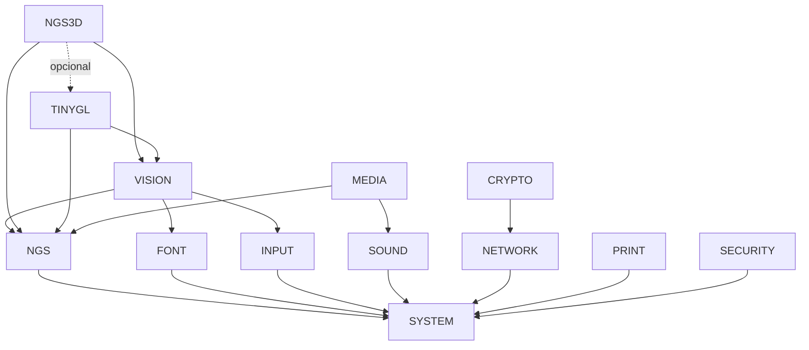

# Bibliotecas nativas LBS — ABI 1

> Actualización posterior: [migración de aplicaciones y CPL](LBS-MIGRATION.md).
> Las LBS ahora se instalan directamente en `/SYSTEM`; el informe inicial
> conserva las mediciones y el alcance de la primera entrega.

LBS significa Libraries. Un archivo `.LBS` es un ELF32/i386 `ET_DYN` real,
compilado con código independiente de posición. Se ejecuta en el espacio de
usuario del proceso que lo carga. No es un driver, un módulo de kernel ni un
formato nuevo.

Las bibliotecas base están en `/SYSTEM/`. `TINYGL.LBS` es un backend
opcional de NGS3D, adicional a las doce bibliotecas de la plataforma.

## Compilar e instalar

Desde la raíz del repositorio:

```sh
make -j8 lbs
make -j8 lbs-audit
python3 tests/lbs/run_qemu.py
python3 tests/lbs/run_qemu.py --memory 64
python3 tests/lbs/run_qemu.py --vga vmware
python3 tests/lbs/run_qemu.py --virgl
```

VirGL requiere QEMU con `virtio-vga-gl`, EGL headless y acceso al render node
`/dev/dri/renderD128`. La prueba registra si el backend realmente envía
triángulos a GPU. La selección de una GPU virtual por sí sola no demuestra
aceleración. Con EGL puede no existir una superficie CPU para `screendump`;
los resultados del framebuffer y las estadísticas se comprueban igualmente.

`make sdk` incluye las LBS. El empaquetador de imágenes instala las bibliotecas
y los archivos de integración del SDK. También se puede generar una copia
actualizada de una imagen BFS4 existente, conservando la original, la primera
etapa de arranque, la configuración del usuario y el prefijo de Wine. Instala
el kernel y la segunda etapa actuales, necesarios para VM/COW nativo:

```sh
python3 tools/install_lbs.py --dry-run
python3 tools/install_lbs.py
# Resultado: build/bleskernos-lbs-user.img
```

La instalación usa una copia temporal y un reemplazo atómico del archivo de
salida. No se debe usar una imagen abierta por QEMU como destino. Las pruebas
usan copias desechables, nunca arrancan el disco original con escritura.

La imagen incluye `/SYSTEM/PROGRAMS/LBSTRI.BEX`, una demostración 3D de
Vision/NGS3D que funciona sin fixtures ni servidor de pruebas. Su fuente es
`sdk/examples/lbs_triangle.c` y usa el CRT declarativo con fallback automático.

## Carga dinámica desde una aplicación

```c
#include <bleskernos_lbs.h>
#include <bleskernos_api.h>
#include <dlfcn.h>

void bleskernos_program_main(void *argument) {
    (void)argument;
    void *library = bk_lbs_open("SYSTEM.LBS", BK_LBS_ABI_MAJOR);
    if (!library) {
        bk_sys_log("No se pudo cargar SYSTEM.LBS\n");
        return;
    }
    uint32_t (*pid)(void) = dlsym(library, "bk_sys_getpid");
    if (pid) {
        uint32_t current = pid();
        (void)current;
    }
    dlclose(library);
}
```

Enlazar el cliente con el puente de importaciones Ring 3, el helper LBS y los
runtimes existentes, en este orden:

```sh
gcc -m32 -ffreestanding -fno-builtin -nostdlib -nostdinc -Os \
  -fno-pic -fno-pie -fno-stack-protector -Isdk/include \
  -c app.c -o app.raw.o
ld -m elf_i386 -r app.raw.o build/sdk/lbs_host.o build/sdk/lbs.o \
  build/sdk/libblesk_lbs_posix.a build/sdk/libblesk_lbs_native.a -o APP.BEX
```

El puente `lbs_host.o` contiene direcciones de los trampolines nativos ya
validados por el cargador ET_REL. No descubre direcciones privadas ni permite
llamar al kernel directamente. Los thunks PIC de las bibliotecas conservan los
argumentos cdecl, incluidos los argumentos ocultos de estructuras. Los
algoritmos de Mesa, TinyGL, Viewer, BearSSL, impresión, mezcla y superficies
residen efectivamente en las bibliotecas dinámicas.

Para reducir el puente a las bibliotecas necesarias y su cierre de dependencias:

```sh
python3 tools/generate_lbs_host.py --modules NETWORK --output build/sdk/my_host.c
gcc -m32 -ffreestanding -fno-builtin -nostdlib -nostdinc -Os \
  -fno-pic -fno-pie -fno-stack-protector -Isdk/include \
  -c build/sdk/my_host.c -o build/sdk/my_host.o
```

El cliente sólo carga sus bibliotecas y dependencias. El puente no carga las
otras LBS. Su coste de arranque y tamaño debe considerarse al migrar programas
pequeños: añadir un cargador y runtime estáticos puede aumentar su tamaño.

## Carga declarativa al iniciar

`sdk/examples/lbs_startup_demo.c` muestra el CRT opcional. Declarar un arreglo
`bk_lbs_requirements` terminado en `{0,0,0}` e implementar
`bk_lbs_program_main(void *)`. El CRT carga y comprueba todas las bibliotecas
antes de entrar a la aplicación. Si falla una, libera el prefijo cargado y no
ejecuta el cuerpo de la aplicación. Al retornar se descargan en orden inverso.

```c
static void *system_library;
const bk_lbs_requirement_t bk_lbs_requirements[] = {
    {"SYSTEM.LBS", 1, &system_library}, {0, 0, 0}
};
void bk_lbs_program_main(void *argument) { /* usar system_library */ }
```

```sh
ld -m elf_i386 -r -u bleskernos_program_main app.raw.o \
  build/sdk/libblesk_lbs.a build/sdk/lbs_host.o \
  build/sdk/libblesk_lbs_posix.a build/sdk/libblesk_lbs_native.a -o APP.BEX
```

Esto es arranque nativo mediante el mismo `dlopen` Ring 3. No transforma el
ET_REL nativo en un ejecutable Linux. Los ET_EXEC/PIE con `PT_INTERP` siguen
utilizando el cargador Linux y su intérprete originales.

## Crear una LBS propia

```c
#include <bleskernos_lbs.h>
const unsigned int bk_example_abi_1 = 1;
static const bk_lbs_info_t info = {
    sizeof(info), 1, 0, "EXAMPLE", BK_SYSCALL_ABI_VERSION
};
const bk_lbs_info_t *bk_lbs_info(void) { return &info; }
int example_answer(void) { return 42; }
```

```sh
gcc -m32 -ffreestanding -fno-builtin -nostdlib -nostdinc -Os \
  -fPIC -fno-stack-protector -Isdk/include -c example.c -o example.o
ld -m elf_i386 -shared --hash-style=sysv -soname EXAMPLE.LBS \
  -z noexecstack -o EXAMPLE.LBS example.o
```

Usar scripts de exportación para ocultar helpers y `--no-as-needed DEP.LBS`
cuando deba conservarse una dependencia contractual. Las importaciones a APIs
nativas del SDK deben estar presentes en el puente del cliente. No importar
funciones privadas del kernel. Un cliente puede suministrar además su propio
puente explícito para servicios de usuario.

El cargador procesa `PT_LOAD`, SysV hash, `DT_NEEDED`, REL i386, `DT_INIT`,
`DT_FINI` y arrays de constructores/destructores. Admite `R_386_32`, `PC32`,
`GLOB_DAT`, `JMP_SLOT`, `RELATIVE` y símbolos absolutos o weak. Resuelve PLT de
forma inmediata, incluso si se pide `RTLD_LAZY`. No implementa TLS tardío,
RELA, GNU symbol versioning ni GNU hash en este cargador del SDK; esos objetos
se rechazan en vez de aparentar ejecutarse correctamente. El cargador Linux
conserva sus propias capacidades de hash y TLS.

Los nombres de dependencia se buscan junto al padre y, para LBS, en el
directorio nativo. Continúan disponibles `/SYSTEM/LIBS/POSIX/` y
`/SYSTEM/LIBS/`. Una SO no adquiere prioridad de búsqueda en el directorio
nativo. Las SO abiertas por nombre relativo siguen admitiéndose desde el cwd.
Las rutas se normalizan para compartir referencias y detectar ciclos.

## ABI y ciclo de vida

* `bk_lbs_open(name, major)` comprueba `bk_lbs_info`: tamaño de descriptor,
  ABI mayor y syscall ABI requerida. El descriptor es extensible por el final.
* Cada biblioteca exporta `bk_<nombre>_abi_1`. Las dependencias oficiales
  importan expresamente los marcadores de sus proveedores; una sustitución
  incompatible que retire el marcador falla durante la relocación.
* Una revisión menor sólo añade funciones o campos al final de estructuras
  versionadas. Un cambio incompatible requiere otro ABI mayor, marcador y
  SONAME/ruta; no reemplazar la ABI 1 por una implementación incompatible.
* Los handles son locales al proceso. `dlopen` repetido suma referencias.
  `dlsym(handle, ...)` consulta el módulo y su cierre de dependencias.
  `RTLD_LOCAL` no publica símbolos para módulos no relacionados.
* Si una relocación importa un proveedor `RTLD_GLOBAL`, el cargador retiene
  ese proveedor hasta descargar al consumidor.
* `dlclose` valida el handle, ejecuta destructores en orden inverso y libera
  dependencias, imagen, nombre y tablas. Antes de liberar un grafo comprueba
  los contadores de recursos de los módulos que perderían su última referencia.
  La descarga se rechaza mientras existan superficies, estados INPUT, contextos
  NGS3D, videos o trabajos PRINT abiertos.
* Liberar objetos y detener workers antes de soltar el último handle.
  Las funciones `bk_mesa_*`/`bk_tinygl_*` de compatibilidad, punteros crudos y
  callbacks ajenos al API administrado requieren retención explícita del handle.
  `bk_dl_pin(handle)` conserva permanentemente el módulo y sus dependencias
  hasta terminar el proceso cuando hay callbacks o código cuya vida no puede
  garantizarse. No hay un recolector de punteros de función arbitrarios.
* Las operaciones del cargador están serializadas con un lock recursivo por
  hilo. `dlerror` reserva una clave del TLS existente. Si se agotan las claves, conserva un diagnóstico global protegido por el lock. Un constructor puede reentrar desde el
  mismo hilo; no debe esperar a un worker que a su vez espera al cargador.
* Límite actual: 64 módulos, 32 llamadas de carga anidadas, 32 dependencias directas por módulo e imagen de
  hasta 16 MiB. `dlerror` distingue formato, memoria, dependencias, ciclos,
  símbolos, relocaciones y recursos vivos.

## Bibliotecas y APIs

El catálogo de símbolos reales está en [LBS-EXPORTS.md](LBS-EXPORTS.md). Los
headers `sdk/include/bleskernos_api.h` conservan las firmas de las APIs ya
existentes. Las extensiones usan headers separados.

| Biblioteca | Servicios implementados | Límites del backend actual |
|---|---|---|
| SYSTEM | `bk_sys_*`, archivos/directorios, procesos/hilos, tiempo, memoria e información de dispositivos; `bk_lbs_system_abi` | No añade syscalls ni una segunda capa POSIX. |
| VISION | Ventanas, foco, menús, botones, textbox, slider, choice, scrollbars, pestañas dibujadas, alertas, iconos y diálogo de archivos existentes | No inventa contenedores de toolbar/lista ni un nuevo escritorio. |
| SOUND | PCM u8 mono, tono, nombre/disponibilidad del driver, parada, volumen maestro y mezclador saturado `bk_sound_mix_u8` | Los canales deben tener la misma tasa; no promete latencia ni formatos que el driver no admita. |
| NETWORK | TCP/UDP, bind/listen/accept, DNS, envío/recepción, timeout 0, snapshots e información de interfaces, HTTP/HTTPS | La pila existente tiene loopback TCP; UDP se verifica mediante la interfaz real al host de QEMU. |
| NGS | Primitivas existentes, superficies propias, clipping, blit escalado, composición alfa, daño y presentación | Fallback CPU. El daño evita presentaciones sin cambios; la API pública de presentación de buffers completos aún no permite upload parcial. No se afirma acelerar operaciones sin soporte. |
| NGS3D | Contextos opacos, selección Mesa/TinyGL, color/Z, texturas mediante GL, vertex buffers CPU, triángulos, sync, capacidades/estadísticas y presentación a Vision | Mesa AUTO/SW/GPU/GPU_STRICT. TinyGL opcional AUTO/SW, un contexto TinyGL por proceso. No simula VBO persistente en GPU. |
| MEDIA | BMP/PNG/JPEG/GIF/SVG existentes; video BKV1/2, AVI DIB/MJPEG/PCM, GIF y MPEG1/MP2 de Viewer | No añade codecs nuevos. El stream en memoria es prestado; los frames pertenecen al contexto hasta el siguiente frame/cierre. |
| INPUT | Eventos/foco/cursor/preferencias nativos y estado de teclas, botones y coordenadas por ventana | Alimentar el estado con los eventos reales de Vision. No captura otras aplicaciones ni anuncia gamepads inexistentes. |
| FONT | Enumeración, medición, advances UTF-8 y dibujo/estilos mediante el motor y caché existentes | Selección por ID de las fuentes cargadas por el sistema, sin duplicar cachés en cada DLL. |
| PRINT | Puertos existentes, trabajos BPJ, texto/líneas/bitmaps, submit, ID estable, estado STS y cancelación mediante CAN | Un trabajo PSFILE terminado demuestra un archivo generado, no impresión física. Cancelar en cola es una petición confirmada por STS; un trabajo ya RUN devuelve BUSY. |
| CRYPTO | SHA224/SHA256 y HMAC-SHA256 de BearSSL, borrado sensible, RDRAND sólo si la CPU lo anuncia, consulta de capacidades y servicio HTTPS del proveedor BearSSL | No hay fallback pseudoaleatorio en la API de random. Certificados/TLS usan el almacén y política del proveedor existente, sin API de edición de certificados. Ver limitación de entropía abajo. |
| SECURITY | PID/contexto Ring 3 real; resultados explícitos para operaciones no soportadas | No hay capacidades generales ni autorización arbitraria aplicada por el kernel. `authorize` y `set_privileges` devuelven UNSUPPORTED; UID/GID sintéticos no son protección. |

### Gráficos 3D

Incluir `bleskernos_ngs3d.h`. `bk_ngs3d_create(w,h,backend)` devuelve un contexto
opaco; la ABI no expone Mesa ni estructuras de drivers. Para OpenGL obtener
funciones con `bk_ngs3d_get_proc(context,"glClear")`; de ese modo el mismo
cliente usa Mesa o TinyGL. Los nombres TinyGL se traducen a sus símbolos `tgl*`
existentes. Las funciones GL clásicas de Mesa siguen exportadas para clientes
que eligen ese backend explícitamente.

`BK_NGS3D_AUTO` elige Mesa y permite fallback software. Los valores SOFTWARE,
GPU y GPU_STRICT conservan las políticas existentes. TINYGL_SOFTWARE y
TINYGL_AUTO cargan `TINYGL.LBS` sólo cuando se solicitan. Si falta el plugin,
la selección explícita falla sin crear un contexto falso.

Cada proceso debe serializar su renderizado en un hilo. Las implementaciones
actuales tienen estado de contexto corriente; no se anuncia OpenGL simultáneo
en distintos hilos. Liberar o desacoplar el contexto antes de destruir su
ventana. La biblioteca retira el viewport GPU antes de liberar sus superficies.
Comenzar cada frame TinyGL con `glClear(GL_COLOR_BUFFER_BIT | GL_DEPTH_BUFFER_BIT)`: ése es el límite de frame del backend existente. Dibujar después de presentar sin iniciar otro frame puede usar el fallback CPU.

`bk_ngs3d_pixels` requiere una presentación para lectura (`bk_ngs3d_present(context,NULL)`) previa;
la presentación GPU a una ventana puede conservar el framebuffer en VRAM.

Las mejoras futuras de los backends se distribuyen en las LBS y pueden
beneficiar a clientes ABI 1 sin recompilación. Esto exige preservar las firmas,
los contratos, las estructuras opacas y los marcadores de ABI.

### Audio, impresión y criptografía

El mixer SOUND recibe buffers u8 mono y ganancias 0..256; satura la suma y
conserva el centro silencioso 128. No remuestrea ni inventa soporte de formatos.
El volumen maestro está en 0..100 y el parámetro de volumen PCM conserva la
escala del API existente. El caller conserva sus buffers mientras el driver
los necesite y detiene/relibera el dispositivo antes de descargar código activo.

`print_job_path` se consulta antes de `print_submit`, que consume el trabajo.
El ID queda fijado al crear el trabajo. `bk_print_job_status` lee el estado
real del spooler, incluso su HISTORY. `bk_print_job_cancel_queued` escribe el
control CAN del protocolo existente; existe una carrera normal con el inicio
del trabajo, por lo que el estado final es la confirmación.

`bk_crypto_random` devuelve UNSUPPORTED si no existe RDRAND. Si el hardware no
entrega datos después de sus reintentos, limpia el buffer y devuelve error.
No deriva secretos de relojes, PID ni direcciones. La API HTTPS conserva
validación X.509 y CA del TLS existente. **El proveedor TLS anterior todavía
admite una semilla temporal cuando falta RDRAND; esta implementación no la
certifica como entropía segura.** Tener el servicio TLS disponible no es una
promesa de CSPRNG. Falta un servicio de entropía del kernel para ese escenario.

## Dependencias y memoria

El grafo fuente autoritativo está en `sdk/lbs/dependencies.json`; la auditoría
comprueba el grafo del ELF construido y que cada importación entre LBS tenga
su dependencia real. Resumen:



También hay dependencias directas SYSTEM en los módulos superiores. No hay
ciclos. El CRT admite hasta 32 requisitos iniciales y revierte errores. La demo completa debe ejecutarse con `run_qemu.py`, que prepara el servidor UDP y los recursos de prueba.

Las LBS nativas PIC ahora comparten **páginas físicas de código y constantes**
mediante mappings de archivo privados y de sólo lectura. Cada proceso conserva
sus datos, BSS, GOT y relocaciones. Una escritura autorizada con `mprotect`
produce una copia privada; escribir directamente en código RO termina el proceso.
El backend usa las syscalls VM existentes, sin cambiar la ABI pública. Requiere
recompilar los clientes con el cargador actual y arrancar el kernel actualizado.
El camino heredado `.SO` conserva su asignación anterior.

[Memoria compartida y evidencia física](LBS-SHARING.md) explica el mecanismo,
los ajustes del kernel, las pruebas y sus límites. i386 sigue sin NX y no se
promete RELRO completo. `bk_dl_statistics.image_bytes` mide tamaño virtual;
`bk_dl_mapping_statistics` distingue mappings de archivo RO y privados, también
en bytes virtuales. Ninguno es un contador de ahorro físico total.
`bk_posix_heap_statistics` distingue asignaciones vivas y arenas reservadas;
una arena vacía retenida por el allocator no es una biblioteca aún cargada.

## Pruebas y mantenimiento

* `run_loader_host.py`: ejecuta el cargador real i386, fixtures positivos y
  corruptos, ciclos, proveedor global retenido, SO relativas, fallo de memoria
  en distintas posiciones, descarga con recursos y concurrencia/TLS de errores.
* `audit_artifacts.py`: ELF/ABI/exportaciones, internals ocultos, grafo,
  cierre de símbolos y compatibilidad de las importaciones nativas finales.
* `run_qemu.py`: prueba Ring 3, procesos simultáneos, memoria, TCP/UDP sobre
  driver virtual, audio, imágenes/video, impresión, ventanas, entrada, gráficos,
  CRT declarativo, migración Network Status, SO POSIX y SDL2.
* `sdk/examples/lbs_demo.c`: demostración y pruebas de integración reproducibles.
* `LBS-REPORT.md`: resultados medidos, archivos, limitaciones y regresiones.

Los tests gráficos observan píxeles y contadores; un contexto creado no basta.
El audio se verifica en el driver virtual, sin afirmar que se escuchó un
altavoz físico. No se probó hardware físico. Las pruebas de arranque de apps no
sustituyen todas las interacciones manuales de cada aplicación.

## Migración ampliada (2026-10-20)

`make lbs-apps` genera 140 clientes clasificados en applications.json. Incluye
36 GUI, dos forwarders, tres salvapantallas, Gears y 98 comandos. Las excepciones
de recuperación y servicio están en exceptions.json. `make lbs-extras` construye
ocho ejecutables opcionales desde las fuentes fijadas en external-source.json.

ARCHIVE.LBS centraliza BKZ1 y ZIP/DEFLATE/CRC de HyperZip. COMMAND.LBS centraliza
la lógica común de comandos. MEDIA expone streaming AVI/MPEG, metadatos, tiempos,
seek/audio y renderizado mediante contextos opacos. Los headers correspondientes
son el contrato de estas ampliaciones. Inicializar y cerrar hzip_archive_t; no
reinicializar un archivo abierto. Los buffers entregados se liberan con bk_sys_free.

Los clientes LBS deben usar **libblesk_lbs_posix.a y libblesk_lbs_native.a**.
Estas variantes reservan __bk_lbs_fd_size/write para el dominio de descriptores
POSIX. bk_file_size/write quedan como importaciones nativas del kernel. Mezclar
los archivos históricos del SDK en ese enlace puede vincular funciones homónimas
con descriptores incompatibles. Los clientes POSIX históricos conservan sus
archivos originales. Las variantes nuevas no cambian la ABI pública del kernel.

La selección del payload ocurre antes de leer el objeto en el empaquetador:
seleccionar una ruta después de crear el archivo temporal instala bytes antiguos.
El test test_payload_selection.py cubre ese recorrido real.


Para migrar un objeto externo previo al runtime, usar `generate_lbs_client.py`
con `--source`, `--output` y `--destination`. Si además abre módulos por nombre
mediante `bk_lbs_open`, declararlos en `--host-modules`: el puente incluirá sus
imports aunque el programa los resuelva con `dlsym`. Esto mantiene la elección
del renderer en Quake II sin imponer NGS3D a su modo software.
